# ShelfLogr

**ShelfLogr** is a full-stack mobile application designed for book tracking, reading analytics, and personalized discovery. Built with a modern hybrid architecture (**Ionic React**, **TypeScript**, **Node.js/Express**, and **PostgreSQL**), the app features instant ISBN barcode scanning, resilient multi-source metadata ingestion, dynamic shelf management, and automated support integration.

---

## Tech Stack

The main technologies used in this project are:

---

## App Preview

  
  
  &nbsp;&nbsp;&nbsp;&nbsp;
  
  &nbsp;&nbsp;&nbsp;&nbsp;
  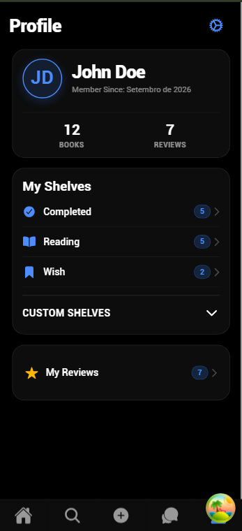
  
  
<i>Home Dashboard • Book Details • Profile & Statistics</i>

 

  
<b>Click here to view all app screens & modals</b>

   

  

    <h4>Home Page & Recommendations</h4>
    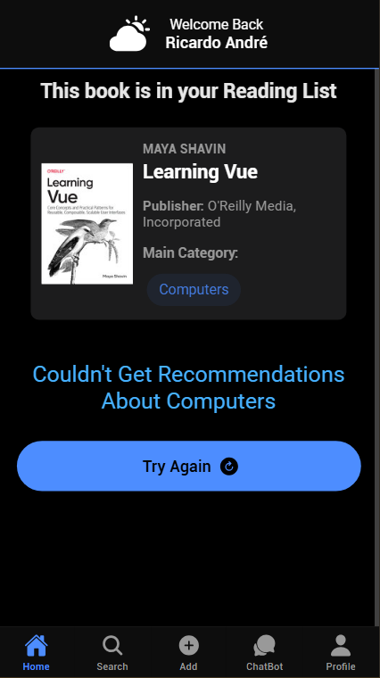
    &nbsp;&nbsp;
    
    &nbsp;&nbsp;
    
    &nbsp;&nbsp;&nbsp;&nbsp;
    <h4>Barcode Scanning & Book Ingestion</h4>
    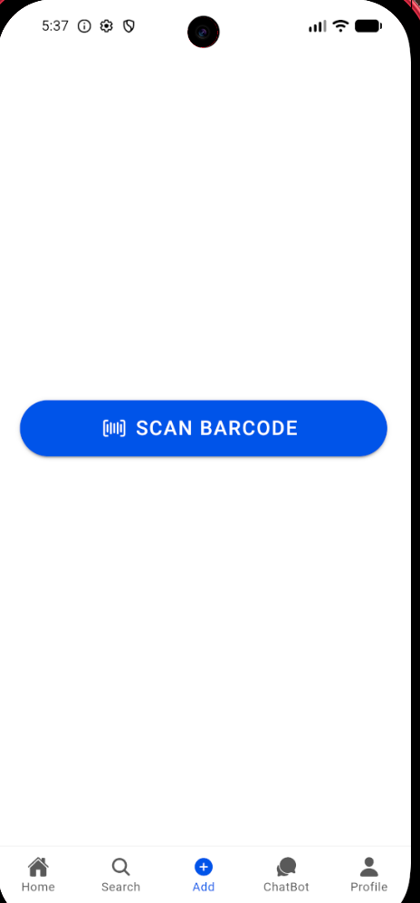
    &nbsp;&nbsp;
    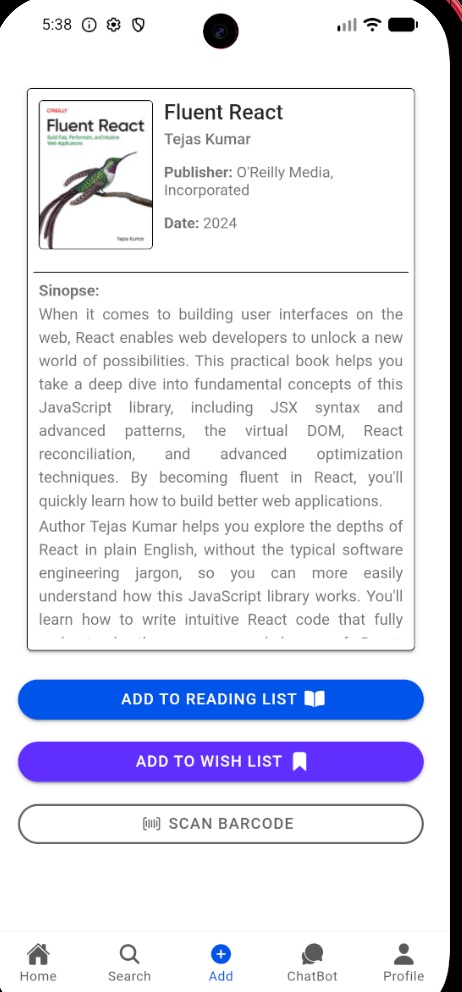
    &nbsp;&nbsp;
    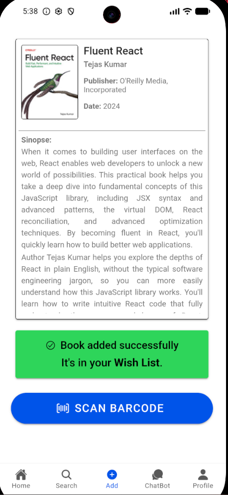
    &nbsp;&nbsp;&nbsp;&nbsp;
    <h4>Book Shelves & Reviews</h4>
    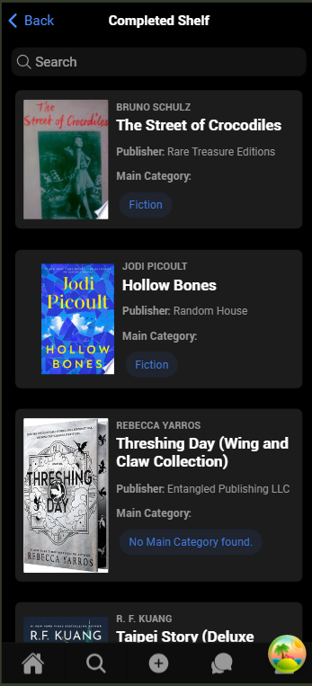
    &nbsp;&nbsp;
    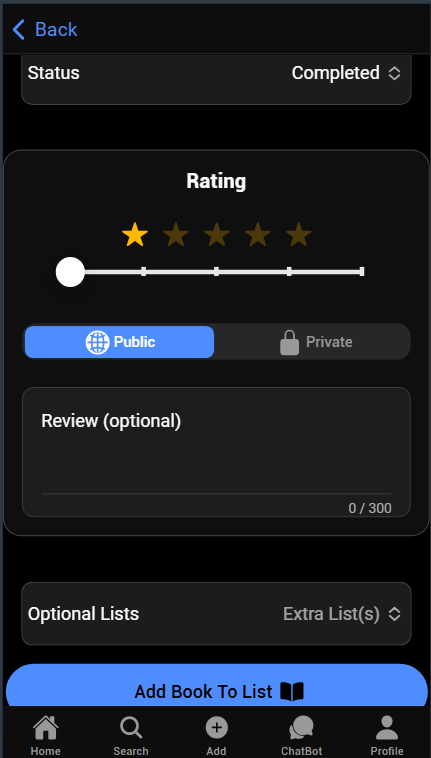
    &nbsp;&nbsp;
    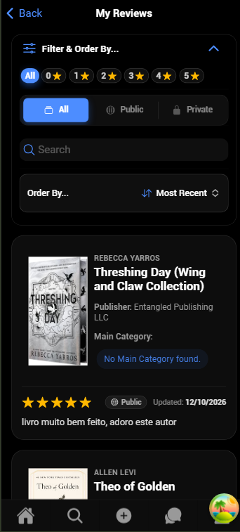
    &nbsp;&nbsp;&nbsp;&nbsp;
    <h4>Account Settings & Sheet Modals</h4>
    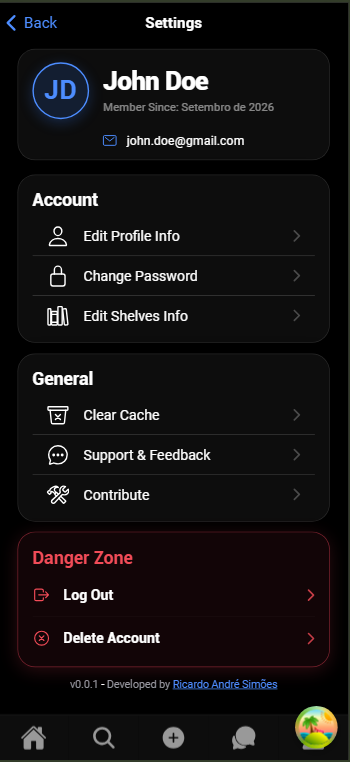
    &nbsp;&nbsp;
    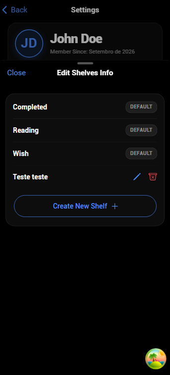
    &nbsp;&nbsp;
    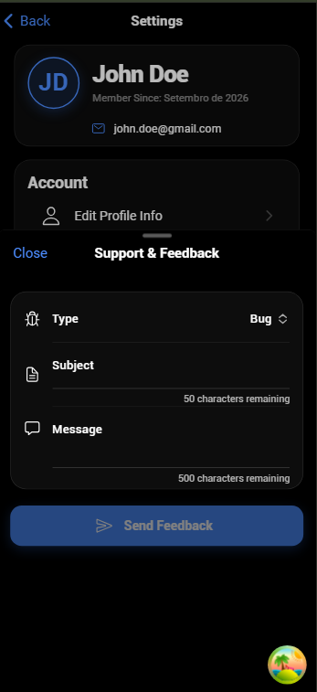

  

---

## App Workflow

**1. Authentication & Navigation:**
The user enters the app and the system immediately checks for a valid token. If the token is invalid or more than 1 day has passed since its expiration date, the user is redirected to the login page. If the token is valid and inside the expiration window, the app navigates directly to the home page. If it is expired but still inside the Grace Period, the front-end refreshes the token in the background and grants access.

**2. Book Scanning Process:**
The user accesses the "Add Book" page, opens the scanner, and scans a barcode. The app verifies the `valueType` property; if it isn't a book barcode, an error is displayed. Otherwise, the app fetches the book information through the Google Books API, or the OpenLibrary API if the Google Books API doesn't return all the needed information, via a dedicated backend endpoint. User gets visual feedback if book is already on one of the shelves, if not, shows buttons that allow the user to add the book to one of the shelves.

**3. Home Page:**
User enters the app and receives a suggestion from the books he is reading, or from his wish shelf (if available and they aren't currently reading any). If user has any completed and liked book, the API gets the main category if available, and fetches books from that category to recommend to the user. If not, does the same but from the NYT API and with no specific category.

**4. Book Page:**
When the user enters the page from the book, it displays the book info and the current state of the book, according to the database. If the book is already added, it displays the shelves, otherwise, allows the user to add to one or multiple shelves. If the user wants to add to the 'Completed' shelf, displays a review form.

**5. Profile Page:**
Users can view their membership details, cumulative reading statistics, and navigate through default shelves (Reading, Wish, Completed) and expandable custom shelves.

**6. Settings & Support:**
Provides account management tools. Modals open as responsive bottom sheets:

- **Edit Profile:** Updates name and email, generating a new JWT token and updating global state seamlessly.
- **Change Password:** Verifies the current password and securely updates credentials with bcrypt hashing.
- **Manage Shelves:** Allows renaming or deleting custom shelves with protective confirmation dialogs.
- **Support & Feedback:** Dispatches rich Discord Webhook embeds categorizing submissions as bugs, feature requests, or general inquiries.

---

## Architectural Decisions & Engineering Challenges

1. **Authentication Lifecycle & Grace Period Flow:**

   - **Challenge:** Balancing security with mobile UX so users aren't prompted to log in every time the app opens.
   - **Decision:** Implemented a client-side **Grace Period** strategy using Capacitor Storage. If a JWT token is valid, access is instantaneous. If it expired within a 1-day acceptance window, the app seamlessly refreshes the token in the background via Axios interceptors without interrupting the user.

2. **Secure Backend Proxy & Multi-Source API Fallback:**

   - **Challenge:** Third-party book APIs often return incomplete metadata (e.g., missing covers, missing genres) and exposing private API keys on the frontend is a security hazard.
   - **Decision:** Built a dedicated Express backend proxy. The mobile client sends only the ISBN; the backend queries Google Books and, if critical information is missing, falls back to OpenLibrary. The server sanitizes and normalizes the payload into a shared `@shelflogr/shared` interface before sending it back.

3. **Hybrid State Management (Server Cache vs. Client State):**

   - **Challenge:** Avoiding prop drilling while keeping server data synchronized and the mobile interface snappy.
   - **Decision:** Separated state responsibilities by pairing **TanStack Query** (handling server state, optimistic updates, and cache invalidation) with **Zustand** (managing lightweight global client state like active tokens and user session data).

4. **Relational Shelf Modeling (System vs. Custom Shelves):**

   - **Challenge:** Providing structured reading workflows while giving users freedom to organize books their own way.
   - **Decision:** Designed a PostgreSQL schema separating mutually exclusive **System Shelves** (`Reading`, `Wish`, `Completed`) from taggable **Custom Shelves** (many-to-many relationship via `shelf_books`). Database integrity rules ensure a book belongs to only one system status while allowing unlimited custom categorization.

5. **External Webhook Integration for Support:**

   - **Challenge:** Creating a real-time, zero-cost support channel for bug tracking and user suggestions without the overhead of building an entire admin dashboard.
   - **Decision:** Integrated native Discord Webhooks on the backend. User tickets submitted through the settings modal are automatically dispatched into private Discord channels with rich, color-coded embeds matching the ticket type (Bug, Feature, Question).

---

## Status

Login and Register implemented. User can scan a Book's barcode to fetch book's info, and receives visual feedback if already in one of their shelves. If not, gives the option to add to one.

Home Page Implemented. Fetches book in user's Reading or Wish Shelf, if exists. Fetches trending books from Google Books API according to user's most read category, or trending books from New York Times API if no info is available from the user

Book Page displays the info from the book and, if the user already added the book, it displays the shelves where the book is added, otherwise, it displays options on shelves where the user can add. If the user wants to add to the 'Completed' shelf, it displays a form for the review

Book Reviews implemented. Users can leave reviews about the completed books

Profile Page implemented. Displays user statistics (total books read/collected, total reviews), quick access to system and custom shelves, and review overview, with native pull-to-refresh.

Settings Page implemented. Features dynamic bottom-sheet modals allowing users to edit profile information, update account password, manage custom shelves (create, edit, delete), and submit feedback/bug reports integrated with Discord Webhooks. Also includes account deletion with confirmation alerts and cache clearing. _(Updated: 22/10/2026)_

---

## Roadmap

- [x] Login and Register
- [x] Scan barcode and fetch information
- [x] Add Book to one of the shelves after scanning barcode
- [x] Display a book suggestion from the ones the user is reading on the home page
- [x] Display book suggestions by topic on the home page
- [ ] Search for book by the title, author or category
- [ ] Create chatbot for user interaction
- [x] Create profile page to see user's shelves
- [x] Create settings page
- [x] Users can leave reviews

#### Future Ideas:

- Ability to see other people's accounts, have friends and see their shelves.
- Contribution program, where users can add missing books that the APIs don't know that exist.

---

## Author

I'm [Ricardo André Simões](https://www.linkedin.com/in/ricardo-andré-simões-0716b4280), a Software Developer Enthusiast with a Bachelor's Degree in Computer Engineering from Universidade de Coimbra.
